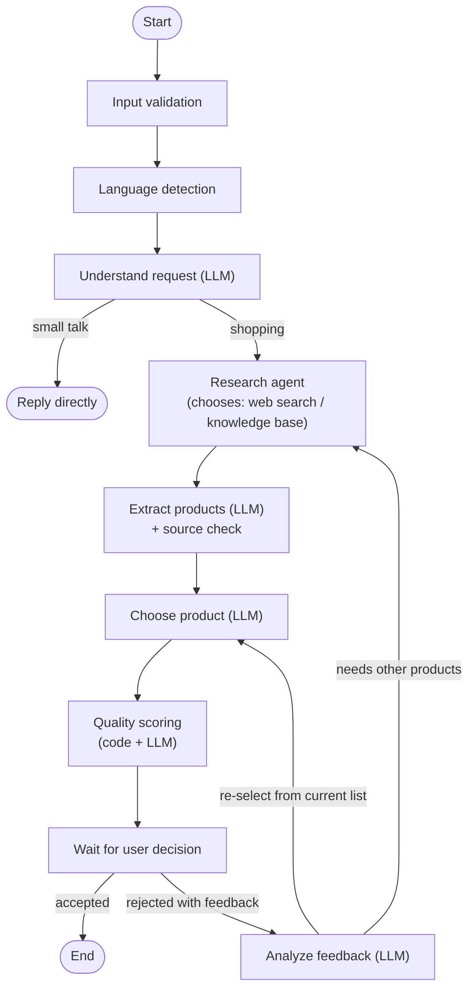

# AI Shopping Assistant Agent — Project Report

This project is a conversational assistant for buying laptops in the Vietnamese market, built with **LangChain** and **LangGraph**. A user states a need in plain language, for example *"a laptop under 25 million VND for AI programming and gaming"*. The system searches products currently listed by Vietnamese retailers, consults a hardware knowledge base, and recommends one product with its reasons, trade-offs and a quality score. It then pauses for the user's decision: the user either accepts the recommendation or describes what should change, and the system refines its answer accordingly.

---

## 1. Problem and objectives

Choosing a laptop requires three kinds of information at once: the buyer's **needs** (budget, intended use, constraints), current **market data** (which models are on sale and at what price), and **technical knowledge** (whether a given GPU is adequate for AI work, how much memory a workload needs). A single call to a language model cannot provide this reliably, because the model has no access to current prices and tends to invent specifications.

The project pursues two objectives:

1. **Demonstrate the core techniques of LangChain and LangGraph** on a realistic problem: a tool-calling agent, a stateful graph with branches and cycles, human-in-the-loop control, retrieval-augmented generation (RAG), streaming, and offline testing of an LLM application.
2. **Keep every answer grounded in retrieved data:** each recommended product must trace back to a real web page, and no price or specification may originate from the model itself.

## 2. Scope

| Supported | Not supported |
|---|---|
| Laptop recommendations for a stated budget, purpose and constraints, in Vietnamese or English | Product categories other than laptops |
| Technical questions about laptop hardware (CPU, GPU, RAM, storage, battery), answered from the knowledge base | Multi-turn conversation memory: each new question starts a new conversation |
| Refinement through feedback: after a rejection, the system either re-selects among the current candidates or searches for new ones | Price tracking, ordering, user accounts |
| Small talk, answered briefly with a redirection to laptop topics | Currencies other than VND and USD (USD is converted at a fixed rate) |

## 3. System architecture

The system consists of a backend (FastAPI and LangGraph) and a chat frontend (React). The backend's processing is a LangGraph state graph of nine steps:



| Step | Role |
|---|---|
| **Input validation** | Normalizes Unicode, removes control characters, and rejects empty or over-long input (more than 500 characters). |
| **Language detection** | Identifies Vietnamese or English, so that every reply is written in the user's language. |
| **Understand request** | A single LLM call classifies the message (shopping or small talk) and extracts budget, purpose, preferences and constraints. Small talk is answered immediately, without running the rest of the pipeline. |
| **Research agent** | The only autonomous agent in the system. The model decides whether to search the web, query the knowledge base, or both, and whether a follow-up search is needed, within a limit of four tool calls. |
| **Extract products** | Turns raw search results into a structured product list (name, price, CPU, GPU, RAM, storage, source URL), converted to VND. |
| **Choose product** | The model selects a candidate by its identifier. Name, price and link are then copied by code from the source data. |
| **Quality scoring** | Combines checks computed in code (real source, within budget, completeness of specifications) with an LLM judgement of how well the product serves the stated purpose. |
| **Wait for user decision** | The graph pauses and the recommendation is shown to the user. |
| **Analyze feedback** | Distinguishes feedback that needs *new products* ("cheaper", "AMD graphics") from feedback that can be met by *re-selecting* among the current candidates. |

**Data sources**

- **Web search:** Tavily, restricted first to six Vietnamese retailers (Thế Giới Di Động, FPT Shop, CellphoneS, GearVN, Phong Vũ, Hacom) and to pages updated within the last year, with the open web as a fallback. Lines that contain prices are extracted from the full page text, since search snippets rarely include them.
- **Knowledge base (RAG):** three guides on CPUs, GPUs, and RAM, storage and battery, split into overlapping chunks, embedded with Gemini `gemini-embedding-001` and stored in a local Qdrant index. Additional PDF or Markdown documents placed in the knowledge folder are indexed as well.

## 4. Reliability and safety

**Grounding.** Search results reach the graph state directly from the tools' output (`ToolMessage.artifact`) and never pass through the model's prose. A product whose source URL is not among the retrieved pages is discarded. The facts extracted for each product are then checked against the text of its source page: a price that does not appear on the page is removed, and a specification is kept only if every number in it (the "4050" of "RTX 4050", the "16" of "16GB") appears there. A value the model filled in from its own knowledge is therefore discarded rather than shown. The final recommendation takes its name, price and link from the selected candidate, not from text written by the model.

**Guardrails.**

| Guard | What it enforces |
|---|---|
| Input guard | Clean, non-empty input of bounded length |
| Tool arguments | Schema validation of every argument the agent passes to a tool |
| Tool results | Search results without a title or URL are dropped, never completed with guessed values |
| Untrusted content | Web content is delimited and marked as data, so that instructions embedded in a page are ignored |
| Privacy | Email addresses are redacted from the agent's input |
| Budget disclosure | A recommendation priced above the budget always states this, even when the model omits it |

**Error handling.** Failures are handled at the level where they can be resolved:

| Failure | Handling |
|---|---|
| Invalid or incomplete structured output | The call is repeated, up to two more times |
| A Gemini API key reaches its quota or is rejected | The request moves to the next key in a pool of keys; exhausted keys are skipped by later requests |
| Temporary provider failure (overload, 5xx, timeout) | The affected step is retried after about 3 and then 6 seconds |
| Research agent failure | A deterministic search with fixed queries replaces the agent's results |
| Failure that persists after these measures | The user receives a clear message (for example, that the AI service is busy) and a **Try again** action, which continues the conversation from the step that failed without repeating completed work. |

**Human control.** No recommendation is final until the user accepts it. The number of consecutive rejections is capped at ten as a safety bound.

**Data retention.** Every step of a conversation is saved as a checkpoint. Conversations idle for more than 24 hours, whether finished, awaiting a decision or stopped by an error, are deleted when the server starts and every hour thereafter, and the freed space is returned to the file system, so the database does not grow without bound.

## 5. LangChain and LangGraph techniques

| Technique | Application in this project |
|---|---|
| **StateGraph, conditional edges, cycles** | Branching on the type of message; a rejection loops back to research or to product selection |
| **Tool-calling agent (`create_agent`)** | Research agent with two tools, a tool-call limit, PII redaction, and API key rotation implemented as middleware |
| **Tool artifacts (`content_and_artifact`)** | The agent reads a short summary of each result, while the complete data goes directly into the graph state |
| **Structured output (Pydantic)** | Every LLM step returns a validated schema; outputs that fail validation are regenerated |
| **Human-in-the-loop** | `interrupt()` pauses the graph; `Command(resume=...)` continues it in a later HTTP request |
| **Checkpointing** | Conversation state is stored in SQLite, so a paused conversation survives a server restart and a failed run can be continued from its last completed step |
| **Streaming** | `get_stream_writer()` emits progress events for each step, delivered to the interface through Server-Sent Events |
| **RetryPolicy** | Steps that call the LLM are retried automatically after temporary provider failures |
| **RAG** | Relevant passages from the knowledge base support technical answers and the reasoning behind a recommendation |
| **Offline testing** | The complete graph runs with a simulated LLM, without network access or API keys |

## 6. Evaluation

The system is verified at two levels:

- **Automated tests** (pytest, 104 tests). 98 of them run by default, without network access or API keys: the complete graph with a simulated LLM, the HTTP and streaming API including error responses and retries, the guards (including fact verification against source pages), the schemas, the key rotation and the pruning of old conversations. Six live tests call the real Gemini and Tavily services and the knowledge index; they consume API quota and run only on request.
- **Evaluation script** (`backend/evals/run_eval.py`). It runs a fixed set of six real queries (three shopping requests in Vietnamese and English, two technical questions, one greeting) against the live services and reports intent accuracy, the share of shopping queries for which products were found, grounding of every product to a retrieved URL, budget compliance, mean quality score, and median and 95th-percentile latency. Each run is saved under `backend/evals/results/`.

## 7. Limitations

- **Response time.** A full shopping request takes roughly half a minute to a minute, dominated by sequential LLM calls and web searches. Progress is streamed step by step, but the total wait remains noticeable.
- **Dependence on search data.** Some specifications, such as battery life, rarely appear in retailer listings, so requests centred on them may end without a confident recommendation.
- **Fixed exchange rate** between USD and VND.
- **Demonstration scope.** The system runs as a single process without user authentication or rate limiting, in line with its purpose as a learning and demonstration project.

## 8. Technology stack

| Component | Technology |
|---|---|
| Agent orchestration | LangGraph, LangChain |
| Language model | Google Gemini `gemini-3.5-flash`, through a pool of rotating API keys |
| Embeddings and vector store | Gemini `gemini-embedding-001`, Qdrant (embedded, local) |
| Web search | Tavily |
| State persistence | SQLite (LangGraph checkpointer) |
| Backend | FastAPI, Pydantic |
| Frontend | React, TypeScript, Vite, Tailwind CSS |
| Testing | pytest, evaluation script with real queries |

---

## Appendix: Running the project

Requirements: Python 3.11, Node.js, a [Tavily](https://tavily.com) API key and one or more [Google AI Studio](https://aistudio.google.com/apikey) API keys.

```bash
# Backend
cd backend
python -m venv .venv && ./.venv/Scripts/activate
pip install -r requirements.txt
cp .env.example .env                  # set TAVILY_API_KEY and GEMMA_API_KEY_1, GEMMA_API_KEY_2, ...
python -m app.rag.vectorstore         # build the knowledge index
uvicorn app.main:app --reload

# Frontend (separate terminal)
cd frontend && npm install && npm run dev    # http://localhost:5173
```

Backend details are described in [backend/README.md](backend/README.md) and the interface in [frontend/README.md](frontend/README.md).
