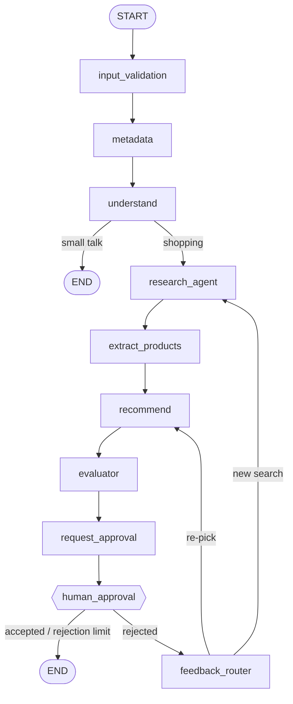

# AI Shopping Assistant

A laptop shopping assistant for the Vietnamese market, built with LangGraph. It searches current retailer listings, consults a small hardware knowledge base, recommends one laptop with reasons and trade-offs, and waits for the user to accept the result or ask for changes.

## Features

- Recommendations from live listings on six Vietnamese retailers, with price, specs and source link
- Hardware Q&A answered from a RAG knowledge base (CPU, GPU, RAM/storage/battery guides)
- Human-in-the-loop: every recommendation pauses the graph; rejection feedback leads to a re-pick or a new search
- Grounded output: products must come from a retrieved page, and prices or spec numbers missing from that page are dropped
- Progress streamed over SSE; conversations persist across restarts and can be retried from the failed step
- Vietnamese and English

## Architecture

FastAPI serves a LangGraph state graph; a React app consumes its SSE endpoints.



| Node | LLM | Purpose |
|---|---|---|
| `input_validation` | – | Normalize Unicode, strip control characters, enforce 1–500 characters |
| `metadata` | – | Detect Vietnamese or English |
| `understand` | 1 call | Classify shopping vs. small talk; extract budget (VND), purpose, preferences, constraints |
| `research_agent` | agent | Choose between web search and the knowledge base, up to 4 tool calls; falls back to a fixed search on failure |
| `extract_products` | 1 call | Turn search results into products; drop ungrounded ones, clear unverified prices/specs, convert to VND |
| `recommend` | 1 call | Code ranks candidates, the model picks one by id; name, price and link are copied from the source data |
| `evaluator` | 1 call | Score 0–1: grounding, budget and spec completeness checked in code, purpose fit judged by the model |
| `request_approval` | – | Announce the pause (separate node so it does not repeat on resume) |
| `human_approval` | – | `interrupt()` and record the user's decision |
| `feedback_router` | 1 call | Decide whether rejection feedback needs new products or a re-pick |

## Tech stack

| Area | Choice |
|---|---|
| Orchestration | LangGraph, LangChain (`create_agent`, middleware) |
| LLM | Gemini `gemini-3.5-flash`, rotating across several API keys |
| RAG | `gemini-embedding-001`, Qdrant (embedded) |
| Web search | Tavily |
| Persistence | SQLite checkpointer |
| Backend | FastAPI, Pydantic |
| Frontend | React, TypeScript, Vite, Tailwind CSS |
| Tests | pytest with a fake LLM; live tests and an eval script against real services |

## Getting started

Requires Python 3.11, Node.js, a [Tavily](https://tavily.com) key and at least one [Google AI Studio](https://aistudio.google.com/apikey) key.

```bash
# backend
cd backend
python -m venv .venv && ./.venv/Scripts/activate   # macOS/Linux: source .venv/bin/activate
pip install -r requirements.txt
cp .env.example .env                                # set TAVILY_API_KEY, GEMMA_API_KEY_1, ...
python -m app.rag.vectorstore                       # build the knowledge index
uvicorn app.main:app --reload                       # http://127.0.0.1:8000

# frontend
cd frontend
npm install
npm run dev                                         # http://localhost:5173
```

## Testing

```bash
cd backend
pytest                    # offline: full graph with a fake LLM, API, guards
pytest -m live            # real Gemini/Tavily/index; uses API quota
python -m evals.run_eval  # fixed query set against live services
```

## Repository layout

```
backend/
  app/
    graph/      state graph, state, one module per node
    tools/      agent tools, Tavily client, currency/price/spec helpers
    rag/        loading, chunking, embeddings, Qdrant index
    guards/     input, tool results, grounding, budget disclosure
    core/       config, Gemini client + key rotation, errors, checkpointer, logging
    api/        HTTP endpoints and schemas
  data/knowledge/   RAG source documents
  evals/        evaluation script and query set
  tests/
frontend/src/   chat UI, SSE client, conversation state
```

## Design notes

- **One agent.** Only research needs decisions that depend on intermediate results (what to search, where, whether to search again). Every other step is a single structured-output call or plain code.
- **Data bypasses model prose.** Tools return `content_and_artifact`: the agent reads a trimmed summary, while full results go into graph state from `ToolMessage.artifact`.
- **Failure handling by layer.** Invalid structured output is regenerated; a key that hits its quota is rotated out; provider 5xx/timeouts are retried by `RetryPolicy`; an agent failure falls back to a fixed search; anything left is returned as a user-facing error with a retry that resumes from the checkpoint.
- **Retention.** Conversations idle for 24 hours are pruned from the checkpoint database at startup and hourly.

## Limitations

- A shopping query takes roughly 30–60 s in live runs (sequential LLM calls and searches).
- No memory across questions; each question starts a new conversation.
- Laptops only; USD is converted to VND at a fixed rate.
- Some specs (e.g. battery life) rarely appear in listings.
- Single process, no authentication or rate limiting.

See [backend/README.md](backend/README.md) and [frontend/README.md](frontend/README.md) for details.
